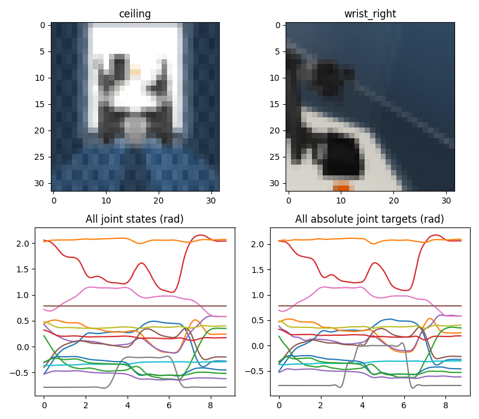
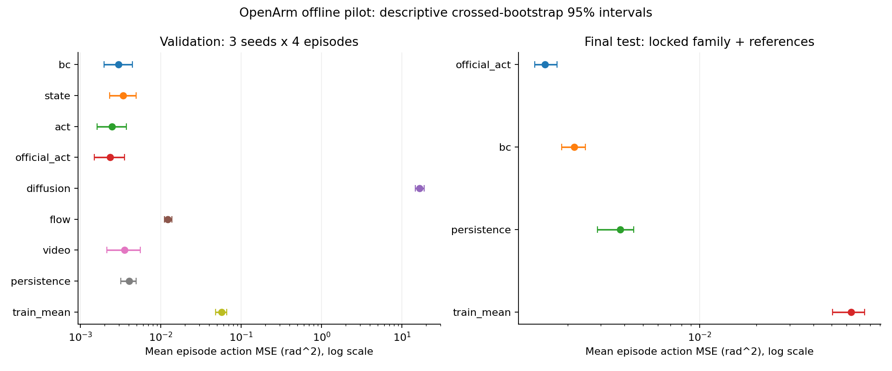

# Vision–Action Research Lab — OpenArm

An independent research laboratory for learning Vision–Action policies on the **OpenArm 2
bimanual pick-up-cube dataset**. OpenArm is the sole active robot manipulation benchmark,
from BC and ACT through diffusion/flow, educational VA pretraining, video–action prediction
and hierarchical control. No personal robotics repository, environment, model or data is used.

## Start on GPU

Python 3.10, PyTorch 2.7.1 / torchvision 0.22.1, LeRobot 0.3.3 and MuJoCo 3.3.2.
The existing `.venv` remains a CPU verification environment. The default training config
requires CUDA and **never silently falls back to CPU**. GTX 1660 Ti development uses FP32,
small batches and gradient accumulation. No drivers or ROS packages are changed.

```bash
bash scripts/setup_gpu.sh
source .venv-gpu/bin/activate
unset PYTHONPATH
export HF_HOME="$PWD/data/hf"
export MUJOCO_GL=egl
va-lab doctor --require-gpu
va-lab verify-lerobot
va-lab download --episodes 30 --cameras ceiling wrist_right --size 32
va-lab inspect --data data/openarm.npz
va-lab train --model bc --output runs/openarm_bc
va-lab train --model state --output runs/openarm_state
va-lab train --model act --output runs/openarm_act
va-lab train --model official_act --output runs/openarm_official_act
```

If the cache already exists, skip download or choose a new output file. Exports and runs
refuse to overwrite existing artifacts. The old local data/checkpoints are retained and
rejected by the new schema-aware loader when incompatible. Historical reports live only in
[the superseded archive](docs/archive/pre_openarm/README.md). `main` preserves the old
implementation; this migration is developed on `feat/openarm-migration`.

## One dataset, every lab

[enactic/openarm-2-cell-pick_up_cube_mujoco-lerobot](https://huggingface.co/datasets/enactic/openarm-2-cell-pick_up_cube_mujoco-lerobot)
contains 30 episodes, 5,405 frames at 30 Hz, five camera views and 16 joint positions/actions.
Use **v2.1** at immutable SHA `c5f7d41a37f9d9456b74eff673870997545c2d25` with LeRobot 0.3.3.
`main` on the dataset is v3 and is not used. Dataset and official assets are Apache-2.0;
original laboratory source remains MIT.

The vector order is right joints 1–7, right gripper, left joints 1–7, left gripper. All 16
values are preserved in every policy. Grippers are signed finger-joint angles, not normalized
open/closed fractions. See [joint/camera semantics](docs/openarm_contract.md) before deployment.

Cached images are `[N,V,3,H,W]` uint8; batches are `[B,V,3,H,W]` floats. Each camera passes
through a shared CNN; ordered per-view features concatenate with joint state. Action chunks
are `[B,K,16]`. The official ACT adapter instead passes each camera under its own LeRobot
feature key. Camera order and all joint names are stored in checkpoints and manifests.



The fixed episode split is **22 train / 4 validation / 4 test**. The 2026-11-08 registered
study selected its family on validation, froze checkpoint hashes, then evaluated the selected
family and BC reference across all three seeds on test. That test set is now **used**. Further
experiments use validation; a new final confirmation needs independent test episodes.

```bash
va-lab evaluate --checkpoint runs/openarm_bc/best.pt --split validation
# Only after selecting the final experiment:
va-lab evaluate --checkpoint runs/openarm_bc/best.pt --split test --output runs/final_test.json
```

## Measured research study

**33 tests passed on the GTX 1660 Ti**, including official data, CUDA gradients, vectorized
window equivalence and final-test selection locks. The main GPU study trained seven families
with three seeds, followed by 18 ACT controls and 15 same-task transfer runs: **54 runs,
648 epochs**. A separate validation-only camera/resolution control added nine fresh
three-epoch runs (two/five views at 32/64 pixels), bringing the total to **63 runs / 675 epochs**. All training and model evaluation used CUDA. The official ACT family selected
on validation achieved test macro-episode action MSE **0.001519 rad²**, versus BC **0.002167
rad²**, on four fixed test episodes. These are small-sample offline results.

Thirty independent-scene control trials (10 per case, 10 simulated seconds each) achieved
**0/10 manipulation successes per case**. Video prediction lost to image persistence;
diffusion remained undertrained. Negative results, paired confidence intervals, runtime,
raw records and confounds are preserved in the [research report](docs/research_report.md).
Exact demonstration-scene reconstruction remains NOT VERIFIED.



Read the Vietnamese [research methodology](docs/research_methodology.md) for math,
source walkthroughs, inference semantics, statistical design and limits of each claim.
The [historical migration checks](docs/validation.md) remain dated records.

```bash
# New output directory required. Review the registered config before spending compute.
python scripts/research.py --output runs/my_registered_study
python scripts/research_extensions.py --study runs/my_registered_study
# Freeze family/checkpoint selection before this explicit final-test step:
python scripts/research.py --output runs/my_registered_study --resume --finalize
MUJOCO_GL=egl python examples/openarm_followups.py \
  --study runs/my_registered_study --output runs/my_followups
```

Full reproduction, including measured-artifact report generation, is documented
[in Vietnamese](docs/reproduction.md). No dataset videos or checkpoint weights are committed.

## Eight-lab curriculum

| Lab | Working implementation | Scope |
|---|---|---|
| [00](labs/lab_00_setup/README.md) | Official LeRobot loading, metadata, all joints, cameras, CUDA doctor | Dataset v2.1 is pinned |
| [01](labs/lab_01_va_fundamentals/README.md) | BC/state-only, GPU train, checkpoints, per-joint RMSE | Offline prediction is not manipulation success |
| [02](labs/lab_02_act/README.md) | Multi-camera educational ACT plus official LeRobot ACT | Reduced width/depth; no paper reproduction claim |
| [03](labs/lab_03_act_ablation/README.md) | Chunk/latent/KL/camera/data-budget grid; horizon and ensemble control | Three-seed one-factor study measured; full factorial/power remains PARTIAL |
| [04](labs/lab_04_diffusion_flow/README.md) | Joint-chunk noise/velocity learning, DDIM/Euler | Compare sampled behavior, not unrelated training losses |
| [05](labs/lab_05_apt/README.md) | Disjoint OpenArm source/target episodes; four transfer arms | Same task only; genuine cross-task transfer NOT VERIFIED |
| [06](labs/lab_06_lingbot_va/README.md) | Multi-camera temporal GRU, future video/actions, PSNR visualization | Educational prototype; large world model NOT IMPLEMENTED |
| [07](labs/lab_07_helix02/README.md) | Official OpenArm Cell assets, 16-target controller, joint mapping, watchdog | Exact demonstration scene NOT VERIFIED |

All tutorials are Vietnamese with English technical terms. Review [executed validation](docs/validation.md),
[limitations](docs/limitations.md), and [reproduction commands](docs/reproduction.md).

## Independent simulation

```bash
va-lab assets
va-lab sim-smoke --render
va-lab rollout --checkpoint runs/openarm_bc/best.pt --allow-unverified-scene
va-lab hierarchy --checkpoint runs/openarm_bc/best.pt --policy-hz 10 --allow-unverified-scene
va-lab record --output data/openarm_collected.npz
```

Official public repositories are acquired into ignored `assets/upstream/` with immutable SHAs,
without symlinks/submodules or previous local integrations. We use the official v2 Cell demo,
not a reconstructed original demonstration environment. Named joint/actuator mapping is
validated; the lifter and mimic fingers are handled explicitly. Camera parameters, gains,
object initial poses and source scene commit cannot be verified as identical to the dataset.
Rollouts therefore require explicit acknowledgment and report **independent-scene results**.

`record` collects real MuJoCo joint-excitation sequences for software and initial representation
experiments. It does **not** manufacture expert cube-pick demonstrations. Add teleoperation or
a verified task controller and diverse tasks before claiming useful action-expert pretraining.

## Engineering

`src/va_lab/` contains datasets, models, training, evaluation, controllers and simulation.
`configs/` holds CPU smoke, low-VRAM GPU and cloud configurations. Training records the exact
split, camera mapping, training-only statistics, dataset hash, GPU/runtime, actual metrics and
peak VRAM. Checkpoint reload rejects a changed dataset. No foundation-model weights download.

```bash
make test lint
python scripts/ablate.py --output runs/openarm_ablation --grid configs/models/act_smoke_ablation.yaml
va-lab train --model diffusion --output runs/openarm_diffusion
va-lab train --model flow --output runs/openarm_flow
va-lab train --model video --output runs/openarm_video
va-lab video --checkpoint runs/openarm_video/best.pt
python scripts/transfer.py --output runs/openarm_transfer
```

Thirty episodes of one task cannot establish broad bimanual generalization. Model success,
sample efficiency and transfer advantages remain hypotheses until measured with adequate
budgets, multiple seeds, held-out episodes and a verified simulator/task protocol.
