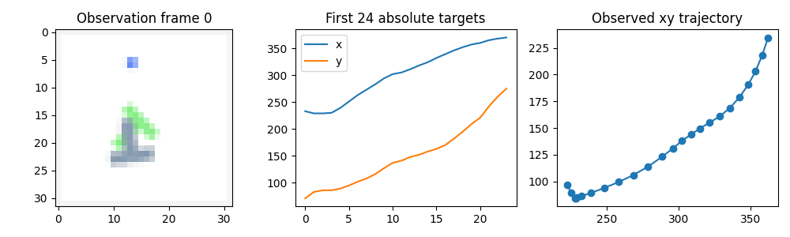
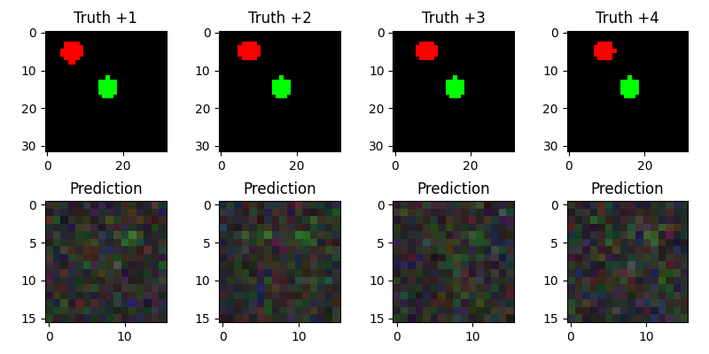

# Kết quả kiểm chứng thực tế — 2026-10-31

Chạy trực tiếp trong môi trường độc lập của repository trên máy hiện tại. Python 3.10.12,
torch 2.7.1+cpu, torchvision 0.22.1+cpu, LeRobot 0.3.3, MuJoCo 3.3.2. CUDA unavailable;
không thay driver/ROS/system Python. Kết quả dưới đây là smoke experiments, không phải
paper reproduction hoặc xếp hạng architecture.

## Kiểm thử đã chạy

- `env -u PYTHONPATH PYTEST_DISABLE_PLUGIN_AUTOLOAD=1 .venv/bin/pytest -q`: **12 passed**.
- Ruff lint và format check đã chạy; `pip check`: no broken requirements.
- Sáu educational models: finite forward/backward và inference; ACT prior không đọc labels.
- Episode split disjoint, training-only statistics, padding mask, history không vượt episode.
- Real training → best checkpoint → reload → evaluation; changed data hash bị từ chối.
- Simulator adapter từ chối checkpoint synthetic khi yêu cầu PushT coordinates.
- Watchdog, nonfinite target, speed bound và temporal ensemble được unit-test.
- MuJoCo physics smoke 10 steps, time 0.1 s, finite qpos.
- Official LeRobot ACT forward/backward và **official LeRobotDataset** đọc episode 0 thật:
  161 frames, image [3,96,96], state/action [2]. Identity synthetic stats chỉ dùng API smoke.
- Official ACT adapter đã train hai epoch trên dữ liệu PushT thật, checkpoint reload và rollout.
- MuJoCo đã ghi 5 episodes PD demonstration; BC train trên bản ghi và chạy hierarchy thật.
- 12 ACT chunk/latent/KL jobs trên synthetic; bốn ACT horizon/ensemble rollout variants.
- APT-inspired source pretraining + random/frozen/partial/full target arms, seed source=7,
  target=17, cùng architecture, target split và epoch budget.
- Two-frame GRU video/action prototype train hai epoch và tạo hình ground-truth/prediction.
  Kết quả hình còn kém, không phải world-model-quality prediction.

## PushT: dữ liệu thật, budget nhỏ

6 episodes, 895 frames, resize 32×32, seed 7, chunk 4, batch 8, 2 epochs.
Train episodes [5,2,0,4], validation [1,3]. Source tag v2.1 được resolve về immutable SHA
`96d10ccbf94cb6ab28fb73431272fc8651141a5d`; main hiện đã chuyển v3 nên không dùng
path v2 trên main. Manifest đầy đủ trong results/pusht_manifest.json.

| Model | Validation normalized action MSE | Mean batch latency CPU (ms) | Rollout success |
|---|---:|---:|---|
| bc | 0.140966 | 0.745 | 0% (2 episodes, 100 steps max) |
| state | 0.121019 | 0.128 | 0% (2 episodes, 100 steps max) |
| act | 1.249213 | 1.414 | 0% (2 episodes, 100 steps max) |
| flow | 0.820747 | 1.761 | 0% (2 episodes, 100 steps max) |
| diffusion | 107.051087 | 2.366 | 0% (2 episodes, 300 steps max) |
| official_act | 0.157777 | 19.108 | 0% (2 episodes, 100 steps max) |

Đây là validation split dùng để chọn checkpoint, không phải untouched final test. Mỗi model
có architecture và objective riêng; official ACT dùng official reconstruction/CVAE loss.
Diffusion dùng 1000 noise training steps, chỉ 10 DDIM inference steps; hai epoch chưa đủ,
MSE còn rất cao. Các generator sample stochastic nên offline point MSE không đo đủ mode
coverage. Rollout success **0%** phải được báo đúng, không đổi thành “policy thành công”.
Diffusion verified CLI rollout chạy max_steps=300; các smoke rollout khác 100. Khác horizon
này làm các rollout chưa phải fair benchmark comparison; xem raw JSON từng experiment.
Latency bị ảnh hưởng cold-start, CPU scheduling, model size và batch cuối; chưa là p50/p95.

## Artifacts và giới hạn

Raw measured JSON nằm trong [results](results/), gồm configs, splits, manifests, evaluations,
ablation, transfer, official API check và hierarchy trajectory. Checkpoints và dữ liệu chỉ
lưu local trong runs/ và data/, không đẩy weights/datasets lên public GitHub.

Hình video sau hai epoch còn nhiễu/mờ; chỉ xác nhận train/inference/visualization path,
chưa đạt future video prediction chất lượng. Không có hidden successful-result claim.
Xem [limitations](limitations.md) và [reproduction](reproduction.md) trước khi tiếp tục.
