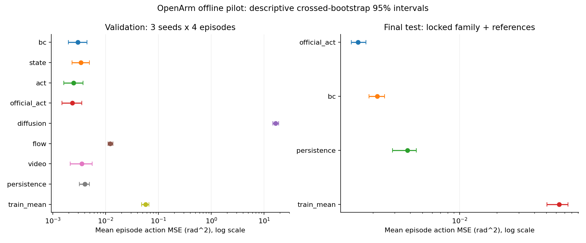
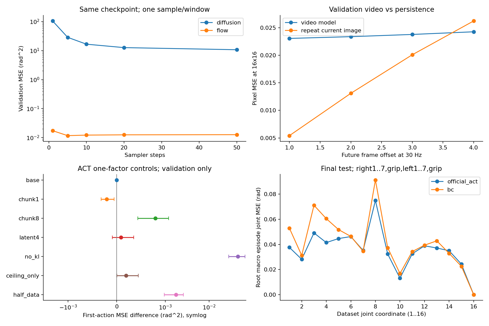

# Báo cáo nghiên cứu OpenArm — 08/11/2026

Đã chạy thật trên GTX 1660 Ti bằng CUDA. Đây là nghiên cứu offline quy mô nhỏ trên một task, kèm thí nghiệm controller trong scene độc lập. Không phải tái lập thành tích foundation model hoặc xác nhận robot gắp cube thành công.

## Thiết kế và khả năng tái lập

- 30 episode / 5.405 frame; dataset v2.1 SHA `c5f7d41a37f9d9456b74eff673870997545c2d25`.
- Split 22 train / 4 validation / 4 test; seed 7. Hai camera ceiling+wrist_right, 32×32, toàn bộ 16 absolute joint positions.
- Bảy họ model × ba seed (7/17/27) = 21 run; 12 epochs/run. ACT one-factor có thêm 18 run; transfer có 15 run gồm source pretrain và bốn target arms cho mỗi seed.
- Tổng **63 run / 675 epoch**. FP32, width64, chunk4, effective batch64; official ACT batch32×accumulation2, ResNet18 không pretrained, reduced Transformer.
- Vectorized windows đặt cache trên CUDA, chia sẻ tensor pool giữa train và validation. Không thay drivers, ROS hoặc system Python.
- Protocol khóa trước training. Checkpoint chọn trên validation objective; family chọn bằng raw macro-episode MSE trung bình ba seed. Không chọn seed đẹp nhất.
- Cả ba seed của family đã chọn và BC reference được đánh giá final test sau selection lock; persistence và train-mean là hai đối chứng. Tập test này **đã được sử dụng**; không còn được gọi là untouched cho nghiên cứu sau.

Định nghĩa metric, toán học từng phương pháp và confounds: [methodology](research_methodology.md). Artifact thô: [protocol](results/research_20261108/protocol.json), [selection](results/research_20261108/selection.json), [training runs](results/research_20261108/training_runs.json).

## So sánh chính

MSE là mean của episode MSE trên seed/episode; CI là 10.000 crossed-bootstrap draws. Với chỉ bốn episode, interval mang tính mô tả và có thể under-cover. sqrt(MSE) không phải mean episode RMSE.

| Family | Validation MSE rad² [CI95] | sqrt(MSE), rad |
|---|---:|---:|
| bc | 0.0029624 [0.0019784, 0.0044424] | 0.05443 |
| state | 0.0034038 [0.0023164, 0.0049220] | 0.05834 |
| act | 0.0024724 [0.0016163, 0.0037072] | 0.04972 |
| official_act | 0.0023344 [0.0014908, 0.0035294] | 0.04832 |
| diffusion | 16.6116356 [14.7604527, 18.7997292] | 4.07574 |
| flow | 0.0122261 [0.0110947, 0.0136760] | 0.11057 |
| video | 0.0035321 [0.0021171, 0.0055380] | 0.05943 |
| persistence | 0.0040390 [0.0031849, 0.0048932] | 0.06355 |
| train_mean | 0.0571697 [0.0479567, 0.0663827] | 0.23910 |

Family được chọn: **official_act**. Đây là lựa chọn trong bảy cấu hình/budget đã đăng ký, không phải kết luận rằng family đó luôn tốt nhất.

| Final test | MSE rad² [CI95] | sqrt(MSE), rad |
|---|---:|---:|
| official_act | 0.0015188 [0.0013411, 0.0017611] | 0.03897 |
| bc | 0.0021672 [0.0018617, 0.0024823] | 0.04655 |
| persistence | 0.0037886 [0.0028775, 0.0044684] | 0.06155 |
| train_mean | 0.0631996 [0.0505681, 0.0744433] | 0.25140 |

Trên đúng split này, selected family có MSE thấp hơn BC 29.9%; paired difference=-0.0006484 [-0.0009069, -0.0004253] rad². Đây là so sánh offline trên bốn test episodes; không chuyển thành manipulation success rate hoặc claim population-level significance.

## Ablation và phân tích thất bại

| ACT control | First-action MSE rad² | Paired difference vs base [CI95] |
|---|---:|---:|
| base | 0.0016357 | 0.0000000 [0.0000000, 0.0000000] |
| chunk1 | 0.0014288 | -0.0002069 [-0.0003206, -0.0000510] |
| chunk8 | 0.0024318 | 0.0007960 [0.0004324, 0.0011932] |
| latent4 | 0.0017225 | 0.0000868 [-0.0000893, 0.0003521] |
| no_kl | 0.0469755 | 0.0453398 [0.0279660, 0.0664834] |
| ceiling_only | 0.0018304 | 0.0001947 [0.0000026, 0.0004450] |
| half_data | 0.0033769 | 0.0017412 [0.0009806, 0.0025763] |

Dùng action +0 để so K=1/4/8 trên cùng endpoint. Đây là sáu one-factor controls, chưa phải full factorial và không có multiple-comparison correction. Half-data giữ cùng epochs nhưng có ít optimizer updates hơn; hiệu ứng data quantity và update count chưa được tách hoàn toàn.

- β=0 tạo train/inference mismatch nghiêm trọng trong budget này: posterior có thể dùng latent trong train nhưng inference dùng z=0. Kết quả không chứng minh mọi CVAE cần cùng một β.
- Diffusion chưa học được sampler đủ tốt; sampled joint MSE còn rất lớn. Không clip output để che lỗi. Flow tốt hơn trong budget này nhưng vẫn thua BC; không chứng minh diffusion/flow nói chung yếu hơn BC.
- Sampler sensitivity dùng cùng checkpoint, validation only, 1/5/10/20/50 bước, một sample/window; không best-of-N. Latency là batch action-sampling latency CUDA-synchronized sau một warm-up, không phải end-to-end control latency.
- Video head pixel MSE=0.023613, baseline giữ ảnh=0.016152. Aggregate model thua persistence trên mọi seed/episode; riêng offset +4 có trung bình thấp hơn persistence. Không có bằng chứng video head đủ tốt cho planning; chưa chạy autoregressive drift/refresh protocol.

## VA prior cùng task

| Target arm | Raw MSE rad² [CI95] | Difference vs random [CI95] |
|---|---:|---:|
| random | 0.0069759 [0.0067005, 0.0073127] | 0.0000000 [0.0000000, 0.0000000] |
| frozen | 0.0058424 [0.0054979, 0.0062710] | -0.0011335 [-0.0015546, -0.0006434] |
| partial | 0.0050774 [0.0049799, 0.0051624] | -0.0018985 [-0.0022228, -0.0017206] |
| full | 0.0046878 [0.0045262, 0.0049865] | -0.0022881 [-0.0027865, -0.0019280] |

Source và target là hai pool rời nhau từ global train. Global validation/test không đi vào source/target training. Chỉ có **một target validation episode**; ba seed đo variability của initialization, không đủ đo generalization. Target head khởi tạo mới; frozen/partial/full chỉ copy encoder. Normalization source/target khác nhau chưa affine-compensated, là confound rõ ràng. Không gọi đây là cross-task transfer, APT reproduction hoặc sample-efficiency advantage.

## Điều khiển trong OpenArm scene độc lập

Mỗi case có 10 reset seeds giống nhau, 300 observation ticks/episode (~10 simulated seconds), checkpoint seed7 cố định. Success là cube lift ≥8cm trong 10 ticks; đây là criterion của lab. Scene/cameras/reset/gains chưa được xác minh giống demonstration dataset.

| Case | Success | Wilson CI95 | Mean tracking error, rad | Policy latency, ms | Inference deadline misses |
|---|---:|---:|---:|---:|---:|
| bc30 (bc, 30Hz) | 0/10 | [0.000, 0.278] | 0.14372 | 0.748 | 0 |
| selected30 (official_act, 30Hz) | 0/10 | [0.000, 0.278] | 0.01603 | 9.222 | 1 |
| selected10 (official_act, 10Hz) | 0/10 | [0.000, 0.278] | 0.01725 | 9.173 | 0 |

Tracking metric là mean của per-tick joint RMSE. Clipping counter của rollout reset ở mỗi episode; followup summary ghi rõ count của **episode cuối**, không gọi đó là tổng 10 episode. Inference deadline chỉ đo policy call, chưa gồm render/IPC/physics. Không đạt task trong các trial này không chứng minh mọi policy đều không thể học task; mismatch scene vẫn là yếu tố chưa kiểm soát.

Chín controller fault cases đã chạy: fresh, đúng timeout, stale, NaN target, Inf target, NaN clock, negative dt, NaN state và sai shape. Hold/rejection/slew bound đều kiểm tra trực tiếp; không phải hardware safety certification.

## Camera/độ phân giải lớn hơn — validation only

Chín run fresh: ba seed cho 2view32, 2view64, 5view64, mỗi run 3 epochs và batch64/accumulation1. Dùng family đã khóa từ main validation; không evaluate lại test. Numeric trajectories và dataset revision giữa hai cache được kiểm tra equality. Đây là exploratory comparison có matched budget riêng, không so trực tiếp với main 12-epoch score.

| Camera/resolution | Validation MSE rad² [CI95] | Difference vs two32 [CI95] |
|---|---:|---:|
| two32 | 0.0038129 [0.0024105, 0.0052595] | 0.0000000 [0.0000000, 0.0000000] |
| two64 | 0.0241968 [0.0182820, 0.0302319] | 0.0203839 [0.0152350, 0.0267930] |
| five64 | 0.0318109 [0.0220717, 0.0429377] | 0.0279980 [0.0187932, 0.0392008] |

Camera count thay đổi input information và model processing/capacity; ba epochs chỉ là pilot. Không dùng kết quả này để sửa family/checkpoint đã chọn hoặc retune bằng final-test labels.

## Compute và kết luận có giới hạn

Telemetry main study: utilization trung bình 43.8%, p95 74.0%, peak 79%; total VRAM peak 1362 MiB (gồm desktop/context).
Peak allocated tensor memory và thời gian từng epoch nằm trong training_runs.json. Epoch time gồm validation nhưng không gồm toàn bộ loading/checkpoint I/O. GPU telemetry không bao gồm followup transfer/rollouts; không đồng nhất tensor allocation với nvidia-smi usage.

Đã hoàn tất một bộ nghiên cứu pilot có code, đối chứng, nhiều seed, test lock, measured negative results và reproduction commands. Chưa hoàn tất xác nhận rộng trên task/scene mới, full factorial sweep, genuine cross-task APT, large video world model hoặc learned hierarchical humanoid control. Các mục đó cần dataset/benchmark/compute và protocol độc lập, không thể thay bằng suy đoán.

Camera study GPU utilization peak 98%, p95 97%; total VRAM peak 4898 MiB.
[Reproduction](reproduction.md) · [Limitations](limitations.md) · [Historical migration evidence](validation.md)
