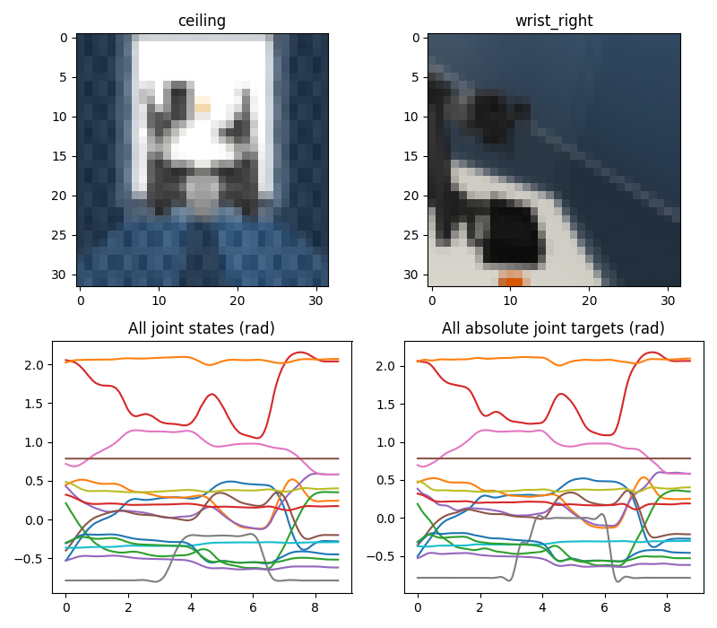
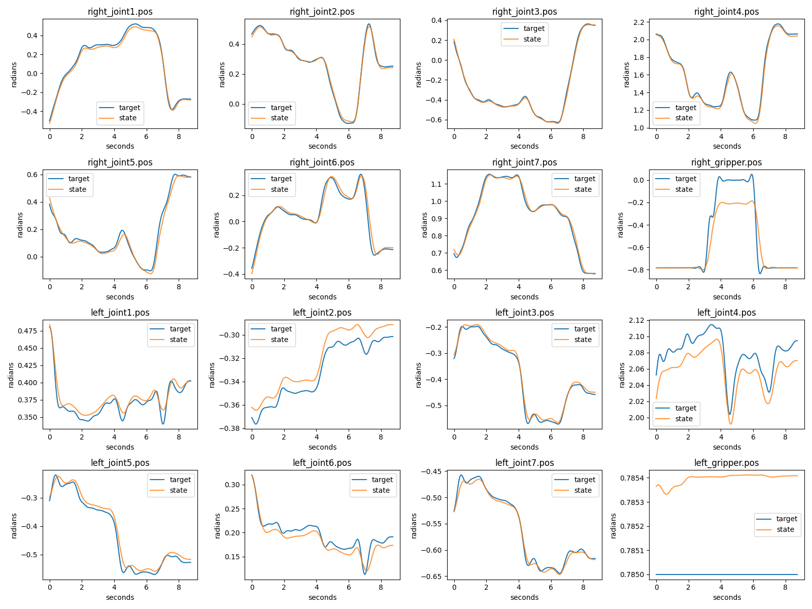
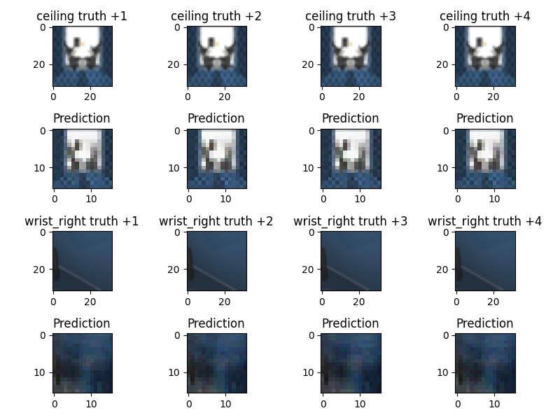

# OpenArm migration validation — 2026-11-02

Feature branch: feat/openarm-migration. Previous main implementation and local data/checkpoints
are preserved. This file records executed evidence; GPU experiment results are added only after
completion, never inferred from source code or diagrams.

## Data — TESTED

Official enactic/openarm-2-cell-pick_up_cube_mujoco-lerobot, exact v2.1 SHA
c5f7d41a37f9d9456b74eff673870997545c2d25. Official LeRobotDataset 0.3.3 decoded episode 0:
263 frames, all five cameras, state/action [16]. All 30 episodes / 5,405 frames and 150 source
videos were acquired into data/openarm_raw (~150 MB). Two-view cache is ~13 MB compressed,
image [5405,2,3,32,32], state/action [5405,16]. A separate real episode-0 five-view cache was
exported to verify selecting every camera. Every selected stream's frame count/PTS was checked;
maximum numeric/video timestamp mismatch: 4.4504801444134046e-7 s (below 1 ms tolerance).

Default split seed 7: 22 training, 4 validation, 4 final test episodes. Final test IDs [2,21,9,11]
are reserved and are not scored by the migration experiments. Upstream global statistics are
retained for inspection, while training recomputes normalization only on its actual train budget.

## CPU regression and official integration — TESTED

`VA_LAB_INTEGRATION=1 PYTEST_DISABLE_PLUGIN_AUTOLOAD=1 .venv/bin/pytest -q`:
24 passed, 5 CUDA tests skipped before the new GPU environment was ready. Tests cover 1/2/5
views, variable state/action dimensions, BC/ACT/diffusion/flow/video finite gradients, history,
padding, train/validation/test disjointness, leakage-free stats, checkpoint reload, explicit
final-test command on synthetic unit fixtures, ordered numeric frames, actual official dataset
loading, simulator joint mapping and command limits. Synthetic fixtures are software tests,
not an alternative manipulation benchmark. GPU test results are recorded separately below.

## Independent official OpenArm simulation — TESTED, dataset scene NOT VERIFIED

Pinned official openarm_mujoco revision a3c8a57ec15d385e3c1dbd3fd090ee486b7f258c,
v2/cell/demo.xml, MuJoCo 3.3.2. nq=26, nu=17, five cameras. All 16 action coordinates map by
verified joint/actuator names; no arbitrary qpos reorder/slicing. Extra lifter held separately.
Physics and EGL rendering run successfully. A stale-command test reached simulated 0.5 s
with finite state and watchdog timeout active. Six independent joint-excitation episodes
were recorded (180 frames); they are not expert cube-pick demonstrations.

Across all demonstrations, 1,799 scalar action targets are outside the current public model's
joint/actuator intersection. Full per-joint bounds/counts are retained in results. This blocks
an exact dataset-equivalent rollout claim. Camera/initialization/dynamics/source-scene identity
remain NOT VERIFIED. Independent rollouts require --allow-unverified-scene and use a separately
documented cube-height criterion; their success is never reported as the dataset benchmark.

## GPU environment — TESTED

Fresh .venv-gpu: PyTorch 2.7.1+cu118, torchvision 0.22.1+cu118, CUDA runtime 11.8,
NVIDIA GeForce GTX 1660 Ti 6,144 MiB, installed driver 595.99.02. A real 256×256 CUDA matrix
forward/backward executed on cuda:0 and produced finite gradients. No NVIDIA driver, ROS,
system Python or old environment was modified. The CPU-only/sandbox failure reported earlier
was not evidence of a broken driver; NVIDIA access works outside the restricted sandbox.

## GPU policy training and checkpoint evaluation — TESTED

Final full suite: **29 passed**, zero skipped, in the fresh GPU environment with
VA_LAB_INTEGRATION=1. Ruff lint, Ruff format check and pip check passed. A separate ACT
forward/backward on real five-camera episode-0 frames passed with image [2,5,3,32,32] and
action [2,4,16] on cuda:0. Versioned raw stdout is retained in results/openarm/pytest_gpu.txt.

Every policy below trained for three epochs on the same 22 train / 4 validation / 4 untouched
test split. Two cameras, 32×32, chunk=4, width=64, FP32, seed=7, split_seed=7. Batch 8 with
accumulation 2; official ACT uses batch 4 with accumulation 4 (same nominal effective batch 16).
Official ACT drops the final partial training batch; its backbone is ResNet18 without downloaded
weights and reduced Transformer depth/width. This is an official implementation with reduced
configuration, not full-budget ACT reproduction. No actual final test episode is scored.

| Model | Validation normalized action MSE | Mean GPU batch inference (ms) | Peak allocated tensor memory (MiB) |
|---|---:|---:|---:|
| bc | 0.063795 | 0.619 | 19.9 |
| state | 0.062890 | 0.291 | 19.5 |
| act | 0.046657 | 1.601 | 21.6 |
| official_act | 0.053096 | 8.909 | 246.3 |
| diffusion | 428.016161 | 3.760 | 20.4 |
| flow | 0.423334 | 2.599 | 20.4 |
| video | 0.084350 | 0.877 | 34.8 |

These are short-run measurements, not a statistically powered ranking. GPU tensor allocation
excludes CUDA context, driver and display memory; it is not total nvidia-smi usage. Batch latency
is not per-action latency, includes cold behavior and is sensitive to scheduling. Raw 16-joint
RMSE vectors, configs, splits, runtimes and per-epoch records are retained per model.

Diffusion validation MSE remains very high after three epochs with 1000 training noise steps
and 10 DDIM inference steps; sampler/noise-model quality is insufficient. It is a genuine finite
training/sampling implementation, not a successful policy. More training and denoising/sampling
ablations are needed. Flow and video likewise have no claimed task-success advantage. Video
PSNR is a pixel metric with strong static-background effects, not evidence of a predictive world
model suitable for planning.

## Additional GPU experiments — TESTED, conclusions limited

- Eight ACT jobs: K={1,4}, camera sets={ceiling; ceiling+wrist_right}, training fraction={0.5,1}.
  Split/validation/test IDs stay identical; raw-joint RMSE is needed across budget-normalization
  changes. Latent/KL ranges are implemented in the larger grid but not exhaustively run here.
- Same-task source pretraining and random/frozen/partial/full target arms completed. Source and
  target episode IDs are disjoint subsets of the global training pool. Global validation and
  final test remain outside both. This is an initial VA-prior experiment, not genuine cross-task
  transfer or a reproduction of APT.
- BC, ACT execution horizon 2, ACT temporal ensemble, and 10-Hz hierarchical policy each ran
  an independent official OpenArm Cell trial for 30 observation ticks (~1 simulated second).
  All four recorded **0/1 manipulation successes**. These are controller/rollout smoke checks,
  not evidence of an effective cube-pick policy and not a dataset-equivalent evaluation.
- BC tracking RMSE was about 0.04869 rad; 10-Hz hierarchy about 0.04666 rad. Clipping counts,
  inference latency and cold-start policy-deadline misses are included in independent_rollouts.json.
  Deadline counts cover policy inference only; they do not certify end-to-end real-time execution.

## Status summary

| Capability | Status |
|---|---|
| 30-episode official loading, timestamp/schema validation, all camera selection | IMPLEMENTED / TESTED |
| GPU forward/backward, seven real-data policy runs, checkpoint reload, offline validation | IMPLEMENTED / TESTED |
| OpenArm asset acquisition, named mapping, controller, EGL rendering and independent rollouts | IMPLEMENTED / TESTED |
| Exact original demonstration scene/dynamics/camera/reset reconstruction | NOT VERIFIED |
| Reliable learned cube-pick success | NOT ACHIEVED in these smoke trials |
| Full ablation/multiple-seed study, cross-task pretraining, large video world model | PARTIAL / NOT IMPLEMENTED at full research scale |

No remaining critical import/test/dependency blocker prevents reviewing this feature branch.
Main is intentionally not merged. Data, checkpoints, environments and upstream cloned meshes
stay local and ignored; only source, small figures, manifests and measured JSON are published.
